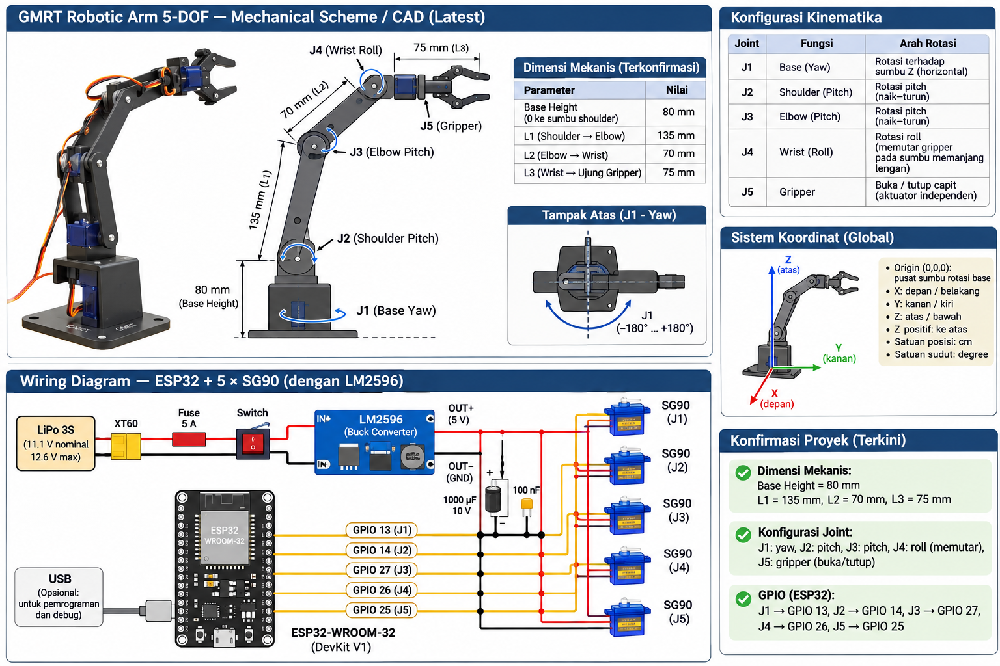
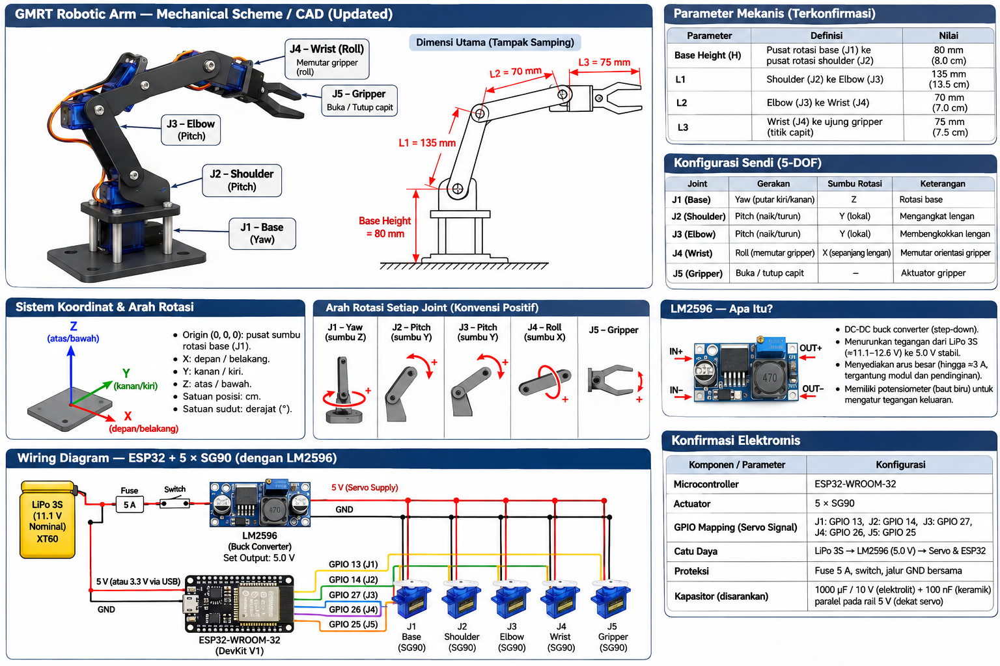
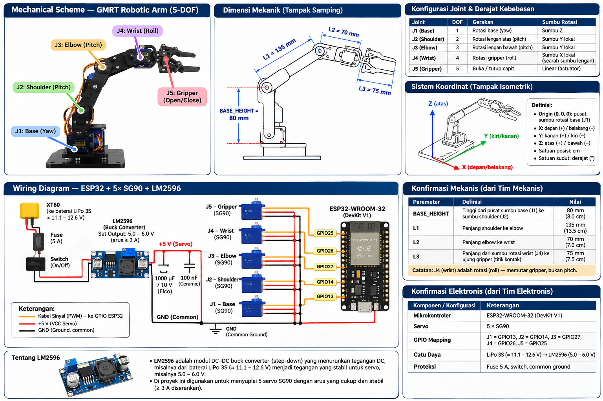

# GMRT Robotic Arm V2

**5-DOF Robotic Arm Firmware | ESP32 | Forward & Inverse Kinematics | Servo Control**

Firmware for the GMRT 5-DOF Robotic Arm prototype, developed using the ESP32 platform. This project integrates mathematical kinematics, joint-space control, Cartesian positioning, servo calibration, and serial-based command handling into a modular embedded firmware architecture.

The firmware is designed to provide a foundation for controlling a five-servo robotic arm, consisting of four motion joints and one gripper actuator.

---

## 1. Project Overview

The GMRT Robotic Arm V2 is a 5-DOF robotic arm prototype controlled by an ESP32 microcontroller.

The firmware translates user-defined joint angles or Cartesian end-effector targets into servo commands. It implements Forward Kinematics (FK) and Inverse Kinematics (IK) to support both joint-space and Cartesian-space control.

### Key Features

- **5-Servo Control** — Independent control of five servo motors.
- **Forward Kinematics (FK)** — Calculates the end-effector pose from joint angles.
- **Inverse Kinematics (IK)** — Calculates joint angles from a target Cartesian pose.
- **Joint-Space Control** — Direct movement through individual joint-angle commands.
- **Cartesian Control** — Position the end effector using Cartesian coordinates and tool pitch.
- **Elbow Configuration** — Supports positive and negative elbow IK solutions.
- **Servo Calibration** — Configurable servo direction, offset, and operating limits.
- **Individual Servo Calibration Mode** — Allows controlled calibration of one servo at a time.
- **Serial Command Interface** — Provides command-based interaction and status output.
- **Motion Safety Controls** — Includes calibration verification gating, command validation, and stop/disarm handling.

---

## 2. Hardware Configuration

### Main Components

| Component | Description |
|---|---|
| Microcontroller | ESP32-WROOM-32 / ESP32 DevKit |
| Actuators | 5 × SG90 Servo Motors |
| J1 | Base Rotation |
| J2 | Shoulder |
| J3 | Elbow |
| J4 | Wrist |
| J5 | Gripper |

### Servo Pin Mapping

| Joint | Function | ESP32 GPIO |
|---|---|---:|
| J1 | Base | GPIO 13 |
| J2 | Shoulder | GPIO 14 |
| J3 | Elbow | GPIO 27 |
| J4 | Wrist | GPIO 26 |
| J5 | Gripper | GPIO 25 |

The pin assignments follow `SERVO_GPIO` in `include/configuration.h` (`{13, 14, 27, 26, 25}` for J1–J5) and should be updated there if the physical wiring changes.

### Power Supply Considerations

The ESP32 and servo motors require an appropriate power distribution arrangement.

**Important:**
- Do not power all five SG90 servos directly from the ESP32 5V output.
- Use a dedicated regulated 5V supply for the servo motors with sufficient current capacity.
- Connect the servo power supply ground and ESP32 ground together (common ground).
- Provide a physical power-disconnect mechanism for emergency shutdown.
- Verify the actual power supply, wiring, and current capacity before operating the arm.

The firmware does not validate the physical power distribution system.

---

## 3. System Architecture

The firmware is organized into separate modules to improve maintainability and isolate mathematical calculations from hardware-level servo control.

### Module Structure

```text
GMRT-RoboticArm-V2/
│
├── include/
│   ├── kinematics.h
│   └── servoController.h
│
├── src/
│   ├── main.cpp
│   ├── kinematics.cpp
│   └── servoController.cpp
│
├── platformio.ini
└── README.md
```

*The structure above represents the intended PlatformIO project organization. Actual filenames may differ depending on the repository version.*

### Module Responsibilities

| Module | Responsibility |
|---|---|
| `main.cpp` | Main firmware, serial interface, command parsing, and control flow |
| `kinematics.h` | Kinematics data structures, declarations, and IK status definitions |
| `kinematics.cpp` | Forward and Inverse Kinematics calculations |
| `servoController.h` | Servo controller class and hardware interface |
| `servoController.cpp` | Servo initialization, attachment, and movement execution |

### Control Flow

```text
          User Input
              |
              v
       Serial Interface
              |
              v
       Command Parser
              |
       +------+------+
       |             |
       v             v
   Joint Mode     Cartesian Mode
       |             |
       |             v
       |         Inverse
       |         Kinematics
       |             |
       +------+------+
              |
              v
      Calibration Mapping
              |
              v
       Joint Limit Check
              |
              v
       Servo Controller
              |
              v
        Physical Servos
```

Forward Kinematics is also used to calculate the resulting end-effector pose from a set of mathematical joint angles.

---

## 4. Kinematics Implementation

The robotic arm uses a working kinematic model consisting of:

- One base rotation joint (J1).
- Three planar rotational joints (J2, J3, and J4).
- One independent gripper actuator (J5).

The four motion joints define the end-effector position and orientation. The gripper is controlled separately.

### Coordinate System

The Cartesian position is represented by:

- `X` — Horizontal position along the X-axis.
- `Y` — Horizontal position along the Y-axis.
- `Z` — Vertical position.
- `toolPitch` — End-effector pitch angle.

Position units are centimeters, while joint angles and tool pitch are represented in degrees at the command interface.

### Arm Geometry

The kinematic model uses four geometry parameters:

| Parameter | Description |
|---|---|
| `baseHeight` | Vertical distance from the base reference to the shoulder plane |
| `L1` | Shoulder-to-elbow link length |
| `L2` | Elbow-to-wrist link length |
| `L3` | Wrist-to-tool reference link length |

These parameters must match the actual mechanical assembly.

**Important:** Geometry values are configuration parameters, not universal dimensions. Update them after measuring the assembled robotic arm.

### 4.1 Forward Kinematics (FK)

Forward Kinematics calculates the end-effector pose from the four motion-joint angles.

Let:

- \(\theta_1\) = Base angle
- \(\theta_2\) = Shoulder angle
- \(\theta_3\) = Elbow angle
- \(\theta_4\) = Wrist angle

The cumulative planar angles are:

\[
\alpha_2 = \theta_2
\]

\[
\alpha_3 = \theta_2+\theta_3
\]

\[
\alpha_4 = \theta_2+\theta_3+\theta_4
\]

The radial distance is:

\[
r=L_1\cos(\alpha_2)
+L_2\cos(\alpha_3)
+L_3\cos(\alpha_4)
\]

The Cartesian coordinates are:

\[
X=r\cos(\theta_1)
\]

\[
Y=r\sin(\theta_1)
\]

\[
Z=H+L_1\sin(\alpha_2)
+L_2\sin(\alpha_3)
+L_3\sin(\alpha_4)
\]

where \(H\) represents the base height.

The tool pitch is:

\[
\phi=\theta_2+\theta_3+\theta_4
\]

### 4.2 Inverse Kinematics (IK)

Inverse Kinematics calculates the required joint angles for a desired Cartesian pose.

The implementation uses a geometric solution based on the law of cosines.

First, calculate the base rotation:

\[
\theta_1=\operatorname{atan2}(Y,X)
\]

Then calculate the wrist-center coordinates:

\[
r_w=\sqrt{X^2+Y^2}-L_3\cos(\phi)
\]

\[
z_w=Z-H-L_3\sin(\phi)
\]

The elbow angle is calculated using:

\[
D=
\frac{r_w^2+z_w^2-L_1^2-L_2^2}
{2L_1L_2}
\]

\[
\theta_3=
\operatorname{atan2}
\left(\pm\sqrt{1-D^2},D\right)
\]

The shoulder angle is:

\[
\theta_2=
\operatorname{atan2}(z_w,r_w)
-
\operatorname{atan2}
\left(
L_2\sin(\theta_3),
L_1+L_2\cos(\theta_3)
\right)
\]

Finally:

\[
\theta_4=\phi-\theta_2-\theta_3
\]

The implementation supports two elbow configurations:

- **Positive elbow solution:** Positive square-root branch.
- **Negative elbow solution:** Negative square-root branch.

### IK Validation

The IK implementation includes:
- Input validation for non-finite values.
- Geometry validation.
- Reachability checking.
- Floating-point tolerance handling.
- Numerical result validation.
- Explicit IK status codes.

The solver can reject a target if it is outside the modeled workspace or if its input geometry is invalid.

A mathematically reachable target does not automatically guarantee that the physical servos can reach it. Servo limits and mechanical constraints must also be satisfied.

---

## 5. Servo Calibration

The calibration layer converts mathematical joint angles into raw servo commands.

A mathematical joint angle and a servo command are not necessarily identical.

The firmware uses calibration parameters to account for servo orientation and mechanical alignment.

Conceptually:

\[
\theta_{\text{joint}}
=
d(\theta_{\text{servo}}-o)
\]

\[
\theta_{\text{servo}}
=
o+d\theta_{\text{joint}}
\]

where:

- \(d\) = Servo direction.
- \(o\) = Servo offset.

Servo operating limits are checked before normal movement commands are executed.

### Individual Servo Calibration Mode

The firmware includes a commissioning mode for testing one servo at a time.

| Command | Description |
|---|---|
| `STATUS` | Display system status |
| `CAL,<joint>,<angle>` | Attach and command one selected servo |
| `CALSTOP` | Detach the currently selected calibration servo |
| `STOP` | Stop calibration output |
| `DISARM` | Detach calibration and all servo channels |

Example:

```text
CAL,1,90
CAL,1,87
CAL,1,93
CALSTOP
```

The calibration command uses the raw servo angle passed to `Servo.write()`, not the mathematical joint angle.

The configured calibration baselines are:

| Joint | Raw Servo Baseline |
|---|---:|
| J1 | 90° |
| J2 | 90° |
| J3 | 90° |
| J4 | 90° |
| J5 | 10° |

The calibration mode restricts commands to a window of ±3° around the configured baseline.

**J5 requires particular attention:** its configured baseline may be close to a mechanical endpoint. Inspect the gripper linkage and verify that it is unloaded and not against a hard stop before attaching or commanding the servo.

The configured baseline is not proof of mechanical safety. Measure and verify each joint before enabling normal arm operation.

### Calibration Verification Lock

The main arm motion lock remains:

```cpp
CALIBRATION_VERIFIED = false
```

This prevents normal arm operation from being treated as commissioned before calibration has been verified.

Do not change this flag to `true` until the mechanical alignment, servo directions, offsets, operating limits, and safe movement ranges have been physically checked.

---

## 6. Serial Command Interface

The firmware provides a serial-based command interface.

### Connection Settings

| Parameter | Value |
|---|---|
| Baud Rate | 115200 |
| Interface | USB Serial Monitor |
| Line Ending | Newline |

### 6.1 Joint-Space Control

Command format:

```text
J,base,shoulder,elbow,wrist,gripper
```

Example:

```text
J,90,90,90,90,90
```

This command specifies the desired raw mathematical joint positions and gripper command through the firmware's calibration and validation layer.

### 6.2 Cartesian Control

Command format:

```text
IK,x,y,z,toolPitch,gripper
```

Example:

```text
IK,10,5,15,45,90
```

The firmware calculates the required joint angles through Inverse Kinematics before converting them into servo commands.

### 6.3 Elbow Configuration

The firmware supports explicit elbow-configuration selection.

```text
IKU,x,y,z,toolPitch,gripper
```

For a positive elbow solution.

```text
IKD,x,y,z,toolPitch,gripper
```

For a negative elbow solution.

The automatic `IK` command attempts the positive elbow solution first.

### 6.4 Help

```text
H
```

Displays the available command information.

### Calibration and Safety Commands

```text
STATUS
CAL,1,90
CALSTOP
STOP
DISARM
```

During calibration commissioning, do not issue normal `ARM`, `J`, or IK movement commands. Follow the firmware's calibration lock and safety procedure.

---

## 7. Software Requirements

The firmware is intended for the ESP32 Arduino framework and can be developed using PlatformIO in Visual Studio Code.

### Required Software

- Visual Studio Code
- PlatformIO IDE extension
- ESP32 Arduino framework
- ESP32Servo library

### Build

Open the project directory in Visual Studio Code with PlatformIO installed.

Build the firmware:

```bash
pio run
```

Upload to the ESP32:

```bash
pio run --target upload
```

Open the serial monitor:

```bash
pio device monitor --baud 115200
```

### Serial Port (must be adjusted)

`platformio.ini` pins `upload_port` and `monitor_port` to **`COM9`**, which is the author's machine port, not a fixed property of the project. Change both values to the port your ESP32 actually enumerates as before building, uploading, or opening the monitor — otherwise PlatformIO fails with a port-open error:

```ini
upload_port = COM9
monitor_port = COM9
```

- Windows: Device Manager → Ports (COM & LPT), e.g. `COM5`, `COM9`
- Linux: `/dev/ttyUSB0` or `/dev/ttyACM0`
- macOS: `/dev/cu.usbserial-*` or `/dev/cu.SLAB_USBtoUART`

Run `pio device list` to see the ports currently attached.

The exact board identifier and library dependencies must match the repository's `platformio.ini` configuration.

---

## 8. Safety Considerations

Robotic arm commissioning involves mechanical, electrical, and software risks.

Before testing:

1. Remove any payload from the gripper.
2. Secure the arm so that gravity cannot cause a link to fall when servo torque is removed.
3. Keep hands and objects clear of the joints.
4. Verify the external servo power supply and common ground.
5. Keep an accessible physical power disconnect.
6. Test one servo at a time during initial calibration.
7. Verify the mechanical endpoints before increasing the movement range.
8. Confirm servo direction and offset before normal operation.
9. Keep the calibration verification lock disabled until commissioning is complete.

**Important distinction:** Detaching a servo stops its PWM control signal. It does not disconnect the external servo power supply.

Software limits cannot guarantee that a mechanism will not collide with another link or reach a mechanical hard stop. Physical inspection and controlled testing remain necessary.

---

## 9. Testing and Validation

The development and validation process should be considered in separate stages.

| Validation Stage | Purpose |
|---|---|
| Mathematical validation | Check FK and IK calculations |
| Software build | Verify compilation for the target ESP32 environment |
| Simulation | Verify command flow and simulated servo behavior |
| Hardware upload | Verify firmware deployment to the ESP32 |
| Servo commissioning | Verify individual servo response and calibration |
| Full arm testing | Verify integrated movement and mechanical behavior |

### FK/IK Verification

An IK solution can be checked by passing its calculated joint angles back into Forward Kinematics.

The resulting Cartesian pose should be compared against the original target.

Position error can be calculated as:

\[
e_p=
\sqrt{
(X_{FK}-X_{target})^2+
(Y_{FK}-Y_{target})^2+
(Z_{FK}-Z_{target})^2
}
\]

Tool-pitch error should also be checked.

This mathematical verification does not replace physical measurement of the end-effector position.

### Hardware Validation Status

Simulation, successful compilation, firmware upload, and physical movement are different validation milestones. A successful result in one stage must not be interpreted as proof of the next stage.

Physical accuracy and safe operating limits depend on the final mechanical assembly, servo calibration, power supply, and measured link dimensions.

---

## 10. Known Limitations

- The kinematic model depends on accurate mechanical dimensions.
- The model assumes a particular joint arrangement and must be checked against the assembled mechanism.
- SG90 servos do not provide direct joint-position feedback to the firmware.
- Servo commands are open-loop; commanded angles do not guarantee exact physical positions.
- Mechanical backlash, load, servo tolerances, and power instability can affect movement accuracy.
- The gripper is controlled independently and is not part of the four-joint Cartesian IK solution.
- A mathematically reachable pose may still violate servo limits or mechanical constraints.
- Calibration baselines must be physically verified before normal operation.

---

## 11. Development Objective

GMRT Robotic Arm V2 aims to establish a modular and extensible firmware foundation for a small 5-DOF robotic arm.

The implementation combines embedded programming, geometric kinematics, actuator control, calibration, and hardware commissioning into one firmware project.

Future development can build on this foundation through improved motion planning, trajectory interpolation, feedback integration, collision handling, and more advanced control strategies.

---

## 12. Design & Blueprints

Design renders and technical drawings of the arm's mechanical layout and electronics packaging. These are design references for the intended build, not fabrication drawings verified against the assembled unit.

### Technical Blueprint



### Engineering Infographic



### Technical Infographic



---

## 13. Author

**Muhammad Daffa Izdihar**  
Programmer Division — GMRT Open Recruitment  
Robotic Arm Firmware Development

---

**GMRT Robotic Arm V2 — Embedded Control & Kinematics**
